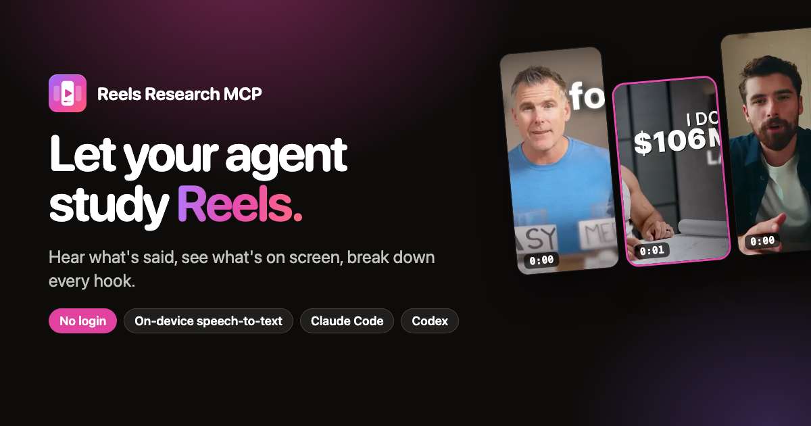

<div align="center">

<a href="https://reels-research-mcp.vercel.app/"></a>

# Reels Research MCP

**A keyless Instagram Reels MCP server and research skill for AI agents.**<br>
Read Instagram Reels without a login: details, timestamped transcripts with on-device speech-to-text (Parakeet Redux, 25 languages), real video frames, preview comments, and Reel links collected from web pages. In Claude Code, Codex and any MCP client.

[Website](https://reels-research-mcp.vercel.app/) ·
[Install](#install) ·
[Tools](#tools) ·
[The skill](#the-research-skill) ·
[FAQ](#faq)


</div>

---

## What it does

Ask your agent things like:

> *"Here are 12 Reels from creators I follow. Break down how each one opens: what's said, what's on screen, and the hook type."*
>
> *"Find Reels about meal-prep for busy parents and summarise the angles they take."*
>
> *"What do these coaches say about pricing? Quote them with the second they said it."*

…and get back verbatim spoken hooks, on-screen text read from real frames, hook types and a coverage line, without logging into Instagram.

## How it works without a login

Instagram shows any logged-out visitor of a public Reel its caption, likes, comment count, date, and the audio and video streams. That is all this server uses:

| Need | How |
|---|---|
| Reel details | Public Reel data via [yt-dlp](https://github.com/yt-dlp/yt-dlp) |
| What's said | The Reel's audio, transcribed **on your machine** with [Moondream Parakeet Redux](https://huggingface.co/moondream/parakeet-redux) (178 MB, 25 European languages, ~50× real time on Apple silicon). Instagram's own captions are only served to logged-in users. |
| What's on screen | Real frames decoded by ffmpeg at any second (only the bytes around each frame are read) |
| Finding Reels | Instagram has no logged-out search, so Reels come from your links or from web pages (`reels_links`) |

## Features

- 🎙️ **Timestamped transcripts, on-device.** Parakeet Redux runs locally through Moondream's Photon runtime in a long-lived worker: ~3 s warm start, then a 45 s Reel transcribes in about a second. Nothing goes to a cloud.
- 🎞️ **Real vertical frames.** Burned-in subtitles, text overlays, b-roll and cut pace become visible to the agent.
- 🔗 **Reels from the web.** `reels_links` pulls every embedded or linked Reel out of up to 15 pages (articles, roundups, newsletters, link-in-bio pages).
- ✂️ **Read only what you need.** A time range (`start: 0, end: 5` for hooks) or only the transcript passages matching a query.
- 🧾 **Nothing disappears silently.** Per-Reel failures carry a reason code (`login_required`, `not_found`, `rate_limited`), music-only Reels are flagged as such.
- 🧠 **A research skill** for hooks (spoken, on-screen and visual), topic sweeps via the web, quotes and write-ups with citations.

## Install

### The easy way: ask your agent

Paste this into Claude Code, Codex, Cursor or any agent that can run commands:

```text
Install Reels Research MCP for me from https://github.com/jindratilk/reels-research-mcp. Follow the "Install instructions for AI agents" in its README for the client you are running in: the plugin (MCP server + research skill) in Claude Code or Codex, otherwise the MCP server config. Run its --setup step for local speech-to-text, then run the doctor and tell me whether everything works, and if I need to restart anything.
```

### Claude Code (plugin: MCP server + skill)

```bash
claude plugin marketplace add jindratilk/reels-research-mcp
```

```bash
claude plugin install reels-research@reels-research
```

```bash
npx -y github:jindratilk/reels-research-mcp --setup
```

### Codex (plugin: MCP server + skill)

```bash
codex plugin marketplace add jindratilk/reels-research-mcp
```

```bash
codex plugin add reels-research@reels-research
```

```bash
npx -y github:jindratilk/reels-research-mcp --setup
```

### Claude Desktop, Cursor, Windsurf, VS Code, Zed, any MCP client

```json
{
  "mcpServers": {
    "reels": {
      "command": "npx",
      "args": ["-y", "github:jindratilk/reels-research-mcp"]
    }
  }
}
```

Then run `npx -y github:jindratilk/reels-research-mcp --setup` once. The skill is optional outside the plugins: copy [`skills/reels-research`](skills/reels-research) into your agent's skills folder.

**Requirements:** Node.js 20+, Python 3.10+, `yt-dlp` and `ffmpeg` (`brew install yt-dlp ffmpeg`). `--setup` creates a private Python environment in `~/.cache/reels-research-mcp` with Moondream's Photon runtime (it brings PyTorch, about 1 GB) and downloads the 178 MB model.

## Install instructions for AI agents

If a user asked you to install Reels Research MCP, follow these steps exactly.

1. **Check prerequisites:** `node --version` (20+), `python3 --version` (3.10+), `yt-dlp --version`, `ffmpeg -version`. If yt-dlp or ffmpeg is missing, offer to install them (`brew install yt-dlp ffmpeg` on macOS); do not install without asking. If Node or Python is missing or too old, stop and tell the user.
2. **Install for the client you are running in:**
   - **Claude Code** (the `claude` CLI exists): `claude plugin marketplace add jindratilk/reels-research-mcp`, then `claude plugin install reels-research@reels-research`.
   - **Codex** (the `codex` CLI exists): `codex plugin marketplace add jindratilk/reels-research-mcp`, then `codex plugin add reels-research@reels-research`.
   - **Any other MCP client:** add `"reels": { "command": "npx", "args": ["-y", "github:jindratilk/reels-research-mcp"] }` to its MCP config, keeping existing entries. Common files: Claude Desktop `~/Library/Application Support/Claude/claude_desktop_config.json` (macOS) or `%APPDATA%\Claude\claude_desktop_config.json` (Windows); Cursor `~/.cursor/mcp.json`; Windsurf `~/.codeium/windsurf/mcp_config.json`; VS Code `.vscode/mcp.json` (uses `servers` instead of `mcpServers`). If the client supports skills, copy `skills/reels-research` into its skills folder.
3. **Set up speech-to-text:** run `npx -y github:jindratilk/reels-research-mcp --setup`. It downloads about 1 GB (PyTorch and the model) into `~/.cache/reels-research-mcp`; tell the user before you start.
4. **Verify:** run `npx -y github:jindratilk/reels-research-mcp --doctor`. Every line should start with ✓.
5. **Tell the user** what you installed, the doctor result, and that they need to start a new session (or restart the app) for the tools to appear.

## Tools

| Tool | What it does |
|---|---|
| [`reels_fetch`](#reels_fetch) | Read up to 20 Reels: details, transcript, frames, preview comments, cover |
| [`reels_links`](#reels_links) | Collect Reel links from up to 15 web pages |
| [`reels_doctor`](#reels_doctor) | Check yt-dlp, ffmpeg, Reel access, the video stream and speech-to-text |

### `reels_fetch`

```json
{
  "reels": ["https://www.instagram.com/reel/DNkpzuaRy-5/", "DO_T5qAEdmo"],
  "parts": ["details", "transcript", "frames"],
  "start": 0,
  "end": 5,
  "frames": 3
}
```

| Parameter | Meaning |
|---|---|
| `reels` | 1–20 Reel URLs (`/reel/`, `/reels/`, `/p/`) or shortcodes |
| `parts` | `details` · `transcript` · `frames` · `comments` · `cover` (default `details`, `transcript`) |
| `start` / `end` | Range for transcript and frames, in seconds or `m:ss` |
| `query` | Return only transcript passages matching these phrases |
| `frames` / `frameAt` / `frameWidth` | N evenly spaced frames, or exact seconds; width up to 1080 px (default 480) |
| `commentsLimit` | Preview comments (Instagram exposes only a handful without login) |

Example output (live, abridged):

```
## [1] @mosseri: AMA: how long should my reels be??
https://www.instagram.com/reel/DNkpzuaRy-5/ · Adam Mosseri (@mosseri) · published 2025-08-20 · 20K likes · 1.1K comments · 0:45
Transcript (speech-to-text) 0:00–0:06:
[0:00] So there is no perfect length for a reel, but generally we recommend reels under three minutes because Instagram is generally focused on shorter video.
Frames (3, 480px wide): attached below at 0:00, 0:02, 0:04
```

### `reels_links`

```json
{ "pages": ["https://blog.example.com/best-instagram-reels", "https://news.example.com/story"] }
```

Finds Reels embedded or linked in the pages (plain links, embeds, escaped JSON, URL-encoded iframes), de-duplicated across pages; `/p/` posts are listed separately.

### `reels_doctor`

No parameters. Also available as `npx -y github:jindratilk/reels-research-mcp --doctor`.

## The research skill

[`skills/reels-research`](skills/reels-research/SKILL.md) guides the agent through a Reels study:

1. **Get the Reels:** the user's links, or a web search for pages that embed Reels on the topic, then `reels_links` ([finding-reels](skills/reels-research/references/finding-reels.md)).
2. **Define the result** before fetching: spoken hook, on-screen text, visual, hook type, likes/day.
3. **Read** in batches of 5–10, hooks with `start: 0, end: 5` and frames ([hooks: 10 Reel hook types](skills/reels-research/references/hooks.md)).
4. **Fan out** to up to 3 Haiku subagents for bigger sets, each reporting `reels_reviewed` and what it skipped.
5. **Verify and cite** as `@handle · Reel URL · second`, with a coverage line ([synthesis](skills/reels-research/references/synthesis.md)).

## Configuration

| Env var | Default | Meaning |
|---|---|---|
| `REELS_MCP_TOOLS` | all | Comma-separated tools to expose |
| `REELS_MAX_CONCURRENCY` / `REELS_MIN_GAP_MS` | 2 / 700 | Instagram lookup pacing |
| `REELS_PROXY` | none | HTTP(S) proxy for yt-dlp and ffmpeg |
| `REELS_PYTHON` / `REELS_VENV` | `~/.cache/reels-research-mcp/venv` | Python with `moondream` installed |
| `REELS_STT_MODEL` / `REELS_STT_DEVICE` | `moondream/parakeet-redux` / auto | Speech model and device (`cpu`, `mps`, `cuda`) |
| `REELS_STT_IDLE_MS` | 600000 | Stop the speech worker after this much idle time |
| `REELS_FRAME_MAX_HEIGHT` / `REELS_FFMPEG_CONCURRENCY` | 1280 / 3 | Frame stream quality and parallel ffmpeg processes |
| `REELS_CACHE_TTL_MS` | 900000 | In-memory cache lifetime |
| `YT_DLP_PATH` / `FFMPEG_PATH` / `FFPROBE_PATH` | on `PATH` | Locate the helpers |

## Honest limits

- **No search inside Instagram.** Logged-out visitors get no search, hashtag pages or profile listings. Reels come from your links or from web pages.
- **No Instagram captions.** Instagram's auto-captions are served only to logged-in users, so transcripts are speech-to-text. Parakeet Redux can mishear names and does worse in loud music or noise.
- **Likes, not views.** View counts are hidden from logged-out visitors.
- **Rate limits.** Instagram throttles anonymous lookups; the server spaces them, and failed Reels say `rate_limited`. Private, age-restricted or region-blocked Reels return `login_required`.
- **Setup size.** Speech-to-text needs about 1 GB (PyTorch plus the model).

## FAQ

**Does it need my Instagram login?** No. Only public data that any logged-out visitor sees. No login, cookies or API key.

**Which languages are transcribed?** The 25 European languages of Parakeet v3 with automatic detection: English, German, French, Spanish, Italian, Portuguese, Dutch, Polish, Czech, Slovak, Ukrainian, Russian, Swedish, Danish, Finnish, Estonian, Latvian, Lithuanian, Hungarian, Romanian, Bulgarian, Croatian, Slovenian, Greek, Maltese.

**Is audio sent anywhere?** No. It is decoded to a temporary file, transcribed locally and deleted.

**Is it affiliated with Instagram or Meta?** No. It is an independent open-source project. Use it in line with Instagram's terms and respect creators' rights.

**Researching YouTube too?** See the sibling project [YouTube Research MCP](https://github.com/jindratilk/youtube-research-mcp).

## Development

```bash
npm install && npm run build
npm test          # offline unit tests
npm run smoke     # end-to-end against live Reels through a real MCP client
```

Layout: `src/instagram.ts` (yt-dlp lookups) · `src/media.ts` (ffmpeg audio and frames) · `src/stt.ts` + `python/worker.py` (Parakeet worker) · `src/tools/*` · `skills/` · `docs/` (website).

## License

[MIT](LICENSE). Parakeet Redux is © Moondream / M87 Labs under CC-BY-4.0, based on NVIDIA Parakeet TDT v3. Not affiliated with Instagram or Meta. Instagram is a trademark of Meta Platforms, Inc.

<sub>Keywords: Instagram Reels MCP server, Instagram Reels transcript without login, Reels hooks research, Model Context Protocol, Claude Code plugin, Codex plugin, on-device speech-to-text, Parakeet, video frames for LLMs, agent skill.</sub>
